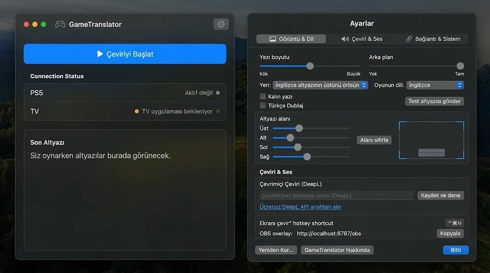

# 🎮 GameTranslator v1.0 Pro — Sefflex Edition
### Konsol Oyunları İçin Gerçek Zamanlı, Sıfır Gecikmeli Türkçe Altyazı Sistemi

[](https://github.com/Sefflex/GameTranslate)
[](https://github.com/Sefflex/GameTranslate)
[-brightgreen?style=flat-square)](#-temel-mantık-3-cümlede-nasıl-çalışıyor)
[](LICENSE)



**GameTranslator**, başta **GTA 6** olmak üzere Türkçe dil desteği bulunmayan PlayStation 5 oyunlarını, televizyonunuzda **sıfır gecikmeyle (0 input lag)**, **4K 120 FPS / HDR görüntü kalitesi zerre bozulmadan** Türkçe altyazıyla oynamanızı sağlayan açık kaynaklı sistemdir.

---

## 🧠 Temel Mantık: 3 Cümlede Nasıl Çalışıyor?

1. **Görüntü TV'de Kalır (0 Lag):** PS5 konsolunuz televizyonunuza doğrudan **HDMI kablosuyla** bağlıdır. Oyunun görüntüsü ve sesi televizyondan doğrudan akar; 4K, 120Hz, HDR kaliteniz aynen korunur, elinizdeki DualSense kumanda sıfır gecikmeyle çalışır.
2. **Bilgisayar Arkada Sessizce Dinler:** Bilgisayarınız (Mac veya Windows PC) evinizdeki yerel ağ üzerinden PS5'e Remote Play ile bağlanır. Kumandanız TV'den kopmasın diye konsola **ücretsiz açtığımız 2. bir hesapla** bağlanır! Bilgisayar sadece görüntüyü okur (OCR) ve İngilizce konuşmaları Türkçeye çevirir.
3. **Televizyona Sadece Altyazı Gider:** Bilgisayar, çevrilen Türkçe metni televizyondaki GameTranslator uygulamasına (TCL/Android TV, LG webOS veya Samsung Tizen) yollar. Televizyon, HDMI'daki oyunun üzerine şeffaf bir katmanla Türkçe altyazıyı orijinal yazının üstüne basar!

---

## 🖥️ Ortak Yerel Masaüstü Tasarımı (Mac & PC)

GameTranslator, hem **macOS (Apple SwiftUI)** hem de **Windows (WPF / .NET 10)** platformlarında aynı sade, şık ve modern koyu arayüzü sunar. Tarayıcı veya harici web sunucusu gerektirmez.

* **Sol Panel (Çeviri Merkezi / Translation Hub):**
  * **▶ Çeviriyi Başlat / ■ Çeviriyi Durdur:** Canlı sistemi tek tıkla başlatan ve durduran yüksek kontrastlı birincil buton.
  * **Connection Status:** PS5 konsolunun ve TV bağlantısının durumunu anlık renkli noktalarla (yeşil/turuncu/gri) bildirir.
  * **🔊 PC Oyun Sesi (Mute / Açık):** Oyunun sesi zaten HDMI kablosuyla televizyonunuzdan geldiği için, bilgisayarınızın hoparlöründen çift ses gelmesini tek tıkla sessize alır (Mute) veya dilediğinizde sesi açar.
  * **Son Altyazı:** Oyunda konuşulan son altyazıyı anlık olarak gösterir ve tek tıkla panoya kopyalama imkanı sunar.

* **Sağ Panel (Entegre Ayarlar & Kalibrasyon Paneli):**
  * **Üst Sekmeler (Segmented Control):** `[ 🖥️ Oyun Okuma Alanı ]`, `[ 📺 TV Görünümü ]`, `[ 🧠 Çeviri & Modeller ]`, `[ 🔗 Bağlantı & Sistem ]`, `[ 📖 Hızlı Rehber ]`.
  * **Oyun Ekranı Altyazı Okuma Alanı:** 16:9 canlı PS5 oyun görüntüsü üzerinde mavi kalibrasyon çerçevesiyle alt yazının okunacağı koordinatları belirleme.
  * **Akıllı TV Örtme & Otomatik Yerleşim:** Oyundaki orijinal İngilizce altyazının boyutunu ve koordinatlarını Vision OCR ile anlık hesaplayarak İngilizce yazıyı kapatır (`İngilizce altyazının üstünü örtsün`), üstüne koyar (`İngilizce altyazının üstünde`) veya altına yerleştirir.
  * **Hassas Kaydırıcılar:** Üst/Alt başlangıç sınırları ve Sol/Sağ sınır ayarları.
  * **Hızlı Seçenekler:** `Alt Orta (Standart)`, `Geniş Alt Bant`, `Tüm Alt Yarı`, `Üst Bölge (Görevler)` ve `Özel Kutu`.
  * **TV Özelleştirme:** Yazı tipi boyutu, alt mesafe oranı, arka plan opaklığı, renk paleti ve Türkçe Dublaj (TTS) desteği.
  * **Kısayol & OBS:** Yayıncılar için yerel OBS Browser Source overlay bağlantısı (`http://localhost:8787/obs`).

---

## 🎯 Platform Kurulum Rehberi (Hiç Kodlama Bilmeyenler İçin Adım Adım)

> ### 📄 Resimli & Adım Adım TV Kurulum Kılavuzu (PDF)
> Televizyonunuza (Android TV, LG webOS, Samsung Tizen) uygulamanın nasıl kurulacağını anlatan, ekran görüntülü ve detaylı Türkçe rehberimizi doğrudan indirebilirsiniz:
> 👉 **[GameTranslator TV Kurulum Rehberi (PDF)](GameTranslator_TV_Kurulum_Rehberi.pdf)** *(Masaüstünüzde ve bu depoda hazır olarak yer almaktadır)*

Aşağıdaki adımları takip ederek 2 dakika içinde oyunu Türkçe altyazıyla oynamaya başlayabilirsiniz.

---

### 1. 🍏 Mac (macOS Kurulumu - Apple Silicon M1 / M2 / M3 / M4)
> Apple Silicon Neural Engine NPU çipini ve Vision OCR donanımını kullanarak **0 ms gecikmeyle** çevrimdışı çalışır.

#### 🟢 Yöntem A: Tek Tıkla Otomatik Kurulum ve Başlatma (Önerilen)
1. **GitHub'dan İndirin:** Bu sayfanın yukarısındaki yeşil **`<> Code`** butonuna tıklayın ve **`Download ZIP`** seçeneğini seçin. İnen ZIP dosyasını klasöre çıkartın.
2. **Başlatıcıya Çift Tıklayın:** Klasörün içindeki **`GameTranslator.command`** dosyasına çift tıklayın.
   * *İlk Açılışta:* Sistem uygulamanın henüz derlenmediğini otomatik anlar, gerekli motorları derler, Apple Developer sertifikanızla imzalar, `/Applications/GameTranslator.app` olarak kurar ve arayüzü ekrana getirir (yalnızca ilk seferde 10-15 saniye sürer).
   * *Sonraki Açılışlarda:* Doğrudan 1 saniyede açılır!
3. **⚠️ Mac Güvenlik İpuçları (İlk Kez Açarken):**
   * **"Geliştiricisi Doğrulanamadığı İçin Açılamıyor" veya "İzin Yok" derse:**  
     Dosyaya **sağ tıklayın** (veya iki parmakla dokunun), **`Aç`** seçeneğini seçin ve çıkan uyarıda tekrar **`Aç`** butonuna basın. (veya Terminal'de klasöre gidip `chmod +x GameTranslator.command` yazmanız yeterlidir).
   * **"swiftc komutu için geliştirici araçları gerekiyor" uyarısı verirse:**  
     Apple'ın çıkan resmi penceresinde **`Yükle`** butonuna basın; Apple Command Line Tools ücretsiz ve otomatik olarak kurulur.
   * **Ekran Kaydı İzni (Altyazıyı Okumak İçin Şart):**  
     Mac'inizde **`Sistem Ayarları` ➔ `Gizlilik ve Güvenlik` ➔ `Ekran ve Sistem Sesi Kaydı`** bölümüne gidin ve listede **`GameTranslator`** anahtarını **AÇIK (Mavi)** yapın.

#### 🛠️ Yöntem B: Manuel Olarak Kendiniz Derlemek İsterseniz (Terminal İle)
Eğer uygulamayı terminalden kendi ellerinizle derleyip kurmak isterseniz:
1. Mac'inizde **Terminal** uygulamasını açın (Klavyeden `Command + Boşluk` basıp Spotlight'a `Terminal` yazabilirsiniz).
2. İndirdiğiniz proje klasörünün içine girin (Terminal penceresine `cd ` yazıp indirdiğiniz klasörü terminale sürükleyip Enter'a basabilirsiniz):
   ```bash
   cd /klasorun/yolu/GameTranslate-main
   ```
3. Derleme scriptini çalıştırın:
   ```bash
   bash mac/build.sh
   ```
4. Derleme bittiğinde terminalde `✅ Derleme ve kurulum başarıyla tamamlandı!` yazar ve uygulama otomatik olarak `/Applications/GameTranslator.app` konumuna yüklenir.
5. Şimdi ister `GameTranslator.command` dosyasına çift tıklayarak, ister `Uygulamalar` (Applications) klasöründen **`GameTranslator`** ikonuna tıklayarak anında açabilirsiniz!

---

### 2. 🪟 PC (Windows Yerel Masaüstü Kurulumu - Windows 10 / 11)
> C# / .NET 10, WPF ve DirectML / Windows Media OCR altyapısıyla çalışan yerel, donanım hızlandırmalı Windows masaüstü uygulamasıdır.

#### 🟢 Yöntem A: Tek Tıkla Otomatik Kurulum ve Başlatma (Önerilen)
1. **GitHub'dan İndirin:** Bu sayfanın yukarısındaki yeşil **`<> Code`** butonuna tıklayın ve **`Download ZIP`** seçeneğini seçin. İnen ZIP dosyasını klasöre çıkartın (Örneğin: Masaüstünüze veya Belgelerim klasörüne).
2. **Başlatıcıya Çift Tıklayın:** Proje klasöründeki **`GameTranslator.bat`** dosyasına çift tıklayın.
   * *İlk Açılışta:* Bilgisayarınızda .NET SDK kuruluysa sistem gerekli kütüphaneleri otomatik yükler ve GameTranslator koyu modern arayüzünü ekrana getirir.
   * *Bilgisayarınızda .NET Yoksa:* Konsol penceresinde uyarı çıkar, klavyeden `E` tuşlayarak tek tıkla resmi Microsoft indirme sayfasını açabilir ve ücretsiz .NET SDK'yı kurabilirsiniz.
3. **⚠️ Windows Güvenlik ve İpuçları (İlk Kez Açarken):**
   * **Windows Defender "Windows kişisel bilgisayarınızı korudu" (SmartScreen) derse:**  
     Mavi penceredeki **`Ek bilgi`** yazısına tıklayın, ardından altta açılan **`Yine de çalıştır`** butonuna basın. (Açık kaynaklı yeni bağımsız projelerde standarttır, tamamen güvenlidir).
   * **Windows Güvenlik Duvarı (Ağ İzni) uyarısı çıkarsa:**  
     PS5 konsolunuzu ve TV uygulamasını yerel ağda otomatik bulabilmesi için çıkan onay penceresinde **"Özel ağlar (Ev veya iş ağı)"** kutucuğunu işaretleyip **`Erişime izin ver`** butonuna basın.
   * **.NET SDK İndirme Linki:**  
     Bilgisayarınızda .NET yüklü değilse, resmi **[Microsoft .NET SDK İndir (Ücretsiz)](https://dotnet.microsoft.com/download)** sayfasından indirip birkaç tıkla kurabilirsiniz.

#### 🛠️ Yöntem B: Tek Tıkla Bağımsız `.exe` Olarak Derlemek (İsteğe Bağlı)
Eğer her seferinde siyah konsol penceresi beklemeden doğrudan masaüstü ikonu gibi tek bir `GameTranslator.exe` dosyası üretmek isterseniz:
1. Klasördeki **`Derle-Windows.bat`** dosyasına çift tıklayın.
2. Sistem tüm projeyi tek parça bağımsız (Self-Contained) Windows uygulaması olarak derler ve `bin/` klasörüne **`GameTranslator.exe`** olarak kaydeder.
3. Artık sadece bu `GameTranslator.exe` dosyasına çift tıklayarak programı 0 saniyede açabilirsiniz!

#### 💻 Yöntem C: Geliştiriciler İçin Konsol Komutları (PowerShell / CMD)
```cmd
cd /klasor/yolu/GameTranslate-main
dotnet run --project "windows/src/GameTranslator.App/GameTranslator.App.csproj"
```

---

### 3. 📺 Akıllı TV (Smart TV Companion Uygulamaları)
> TV'niz HDMI'daki oyun görüntüsünü oynatırken, üzerine şeffaf bir OSD penceresi açarak Türkçe altyazıyı basar. Hazır derlenmiş paketler `tv/packages/` klasöründedir.
> 
> 💡 **Tüm TV Modelleri İçin Kapsamlı Görsel Rehber:**  
> Televizyonunuza yükleme yaparken görsellerle adım adım takip edebileceğiniz **[GameTranslator TV Kurulum Rehberi (PDF)](GameTranslator_TV_Kurulum_Rehberi.pdf)** belgesine göz atabilirsiniz.

* **TCL / Google TV / Android TV (Sony, Philips, Xiaomi vb.):**
  * **Hazır Paket Dosyası:** `tv/packages/gametranslator-androidtv_1.0.0.apk`
  * **Kurulum Yöntemi 1 (USB ile - En Kolayı):**  
    `gametranslator-androidtv_1.0.0.apk` dosyasını herhangi bir USB flash belleğe kopyalayın, TV'nize takın ve televizyondaki "Dosya Yöneticisi" veya "File Commander" ile APK'ya tıklayıp kurun.
  * **Kurulum Yöntemi 2 (Wi-Fi / Ağ Üzerinden):**  
    Bilgisayarınızdan TV'nin IP adresine kablosuz olarak kurabilirsiniz:
    ```bash
    adb connect <TV-IP-ADRESI>
    adb install tv/packages/gametranslator-androidtv_1.0.0.apk
    ```
  * Televizyonda uygulamayı açıp PS5'in bağlı olduğu HDMI portunu (örneğin HDMI 1) seçin.
* **LG TV (webOS):**
  * **Hazır Paket Dosyası:** `tv/packages/com.gametranslator.tv_1.0.0_all.ipk`
  * TV'de Developer Mode'u açın. webOS Dev Manager aracıyla veya komut satırından kurun:
    ```bash
    ares-install tv/packages/com.gametranslator.tv_1.0.0_all.ipk
    ```
* **Samsung TV (Tizen):**
  * **Hazır Paket Dosyası:** `tv/packages/gametranslator-samsung_1.0.0.wgt`
  * TV'de Geliştirici Modunu açın (Uzaktan kumandada 1-2-3-4-5 tuşlayarak). Tizen CLI ile yükleyin:
    ```bash
    tizen install -n tv/packages/gametranslator-samsung_1.0.0.wgt
    ```

---

### 4. 📱 Mobil Cihazlar & Tabletler (iOS / Android) — 🧪 [Test Aşamasında]
> ⚠️ **Test ve Geliştirme Aşaması:** Akıllı telefonlar ve tabletler (iOS & Android) üzerinden canlı altyazı akışı ve ikinci ekran companion deneyimi şu an **test aşamasındadır (Beta)**.
> * **Geçici Test Yöntemi:** Telefonunuz veya tabletiniz bilgisayarınızla aynı Wi-Fi ağına bağlıyken, mobil tarayıcınızdan (Safari / Chrome) `http://<BILGISAYAR-IP-ADRESI>:8787/obs` adresini açarak altyazıları mobil ekranınızda canlı olarak takip edebilirsiniz.
> * Yerel mobil uygulamalar çok yakında testleri tamamlandığında kullanıma sunulacaktır.

---

## 🎮 PlayStation 5 Ayarı (Kumanda Neden Kopmaz?)

PlayStation normalde Remote Play açılınca elinizdeki kumandayı televizyondan koparır. Bunu aşmak son derece basittir:
1. PS5'te `Ayarlar` ➔ `Sistem` ➔ `Uzaktan Oynatma (Remote Play)` ➔ **Uzaktan Oynatmayı Etkinleştir** seçeneğini **AÇIK** yapın.
2. PS5'inizde **ücretsiz ikinci bir kullanıcı / PSN hesabı** ekleyin (örneğin: `oyunceviri@gmail.com`).
3. **Nasıl Oynayacaksınız?**
   - TV karşısında **kendi ana hesabınızı** açıp kumandanızı elinize alın.
   - Bilgisayar ise arka planda bu **ikinci hesapla** konsola bağlanır.
   - Böylece DualSense kumandanız TV'den **asla kopmaz**!

---

## 🧠 Hangi Çeviri Modeli Ne İşe Yarar?

| Model | Nasıl Çalışır? | Ne Zaman Tercih Edilmeli? |
| :--- | :--- | :--- |
| **1. Apple Yerel (Önerilen)** | Mac'inizin Neural Engine (NPU) yapay zeka çipini kullanır. | **0 ms gecikme sağlar.** Tamamen internetsiz, çevrimdışı, kotasız ve ücretsizdir. |
| **2. Google Gemini 2.5 Flash** | Google Gemini API (AI Studio). | GTA 6 gibi oyunlardaki **sokak argosu, küfürler, şakalar ve hikaye bağlamını** en zeki ve en doğal Türkçeyle çeviren yapay zeka modelidir. |
| **3. DeepL API** | DeepL Free / Pro API. | Dünyanın en bilinen profesyonel çeviri motorudur. Kusursuz dilbilgisi için tercih edilir. |
| **4. Yerel Derin Öğrenme** | Bilgisayarınızın CPU/GPU'sunda yerel çalışan MarianMT / DirectML sinir ağı modeli. | İnternetsiz yerel yapay sinir ağı çevirisi. |

---

## 📁 Proje Klasör Rehberi

```text
GameTranslate/
├── mac/                            # 🍏 macOS Yerel Uygulaması (SwiftUI, Apple Vision OCR, NPU)
│   ├── NativeApp.swift             # Ana masaüstü arayüzü & altyazı motoru
│   ├── build.sh                    # Tek komutla Apple Developer imzalı derleme aracı
│   ├── project.yml                 # XcodeGen proje dosyası
│   └── GameTranslator/             # Varlıklar, ikonlar ve Info.plist
│
├── windows/                        # 🪟 Windows Yerel Uygulaması (.NET 10, C#, WPF, DirectML)
│   ├── GameTranslator.Windows.slnx # Visual Studio / Rider Çözümü
│   ├── src/                        # Modüller (App, Core, RemotePlay, TvInstall)
│   └── native/                     # C/C++ donanım hızlandırma katmanı
│
├── tv/                             # 📺 Akıllı TV Uygulamaları (Companion Apps)
│   ├── android/                    # Android TV & Google TV kaynak kodları (Java/Gradle)
│   ├── webos/                      # LG webOS TV şeffaf altyazı katmanı (HTML5/JS)
│   ├── tizen/                      # Samsung Tizen TV katmanı (Web App)
│   └── packages/                   # Doğrudan TV'ye yüklenebilir hazır derlenmiş paketler:
│       ├── gametranslator-androidtv_1.0.0.apk
│       ├── com.gametranslator.tv_1.0.0_all.ipk
│       └── gametranslator-samsung_1.0.0.wgt
│
├── core/                           # ⚙️ Çekirdek Kütüphane (Ağ, OCR gürültü filtreleme, senkronizasyon)
├── dictionaries/                   # 📚 Oyun sözlükleri (GTA 6 slang & community pack)
├── docs/                           # 📖 Detaylı kurulum rehberleri ve mimari dokümanlar
├── design/                         # 🎨 Vektör logolar, AppIcon ve tasarım bileşenleri
├── scripts/                        # 🛠️ TV paketleme ve derleme otomasyon araçları
│
├── GameTranslator.command          # 🚀 Mac tek tıkla başlatıcı
├── GameTranslator.bat              # 🚀 Windows tek tıkla başlatıcı
├── README.md                       # Açık kaynak proje dokümantasyonu
└── LICENSE                         # AGPL-3.0 Açık Kaynak Lisansı
```

---

## 👨‍💻 Geliştiriciler İçin: Kodları Derleme

```bash
# 🍏 macOS Uygulamasını Derleme (Apple Silicon):
bash mac/build.sh

# 🪟 Windows Projesini Derleme ve Çalıştırma:
dotnet run --project windows/src/GameTranslator.App/GameTranslator.App.csproj

# 📺 Android TV APK'sını Kaynak Kodundan Derleme:
cd tv/android && ./gradlew assembleRelease

# ⚙️ Core Swift Kütüphanesini Derleme:
swift build --package-path core
```

---

## ⚖️ Lisans & Telif Hakkı

Bu proje **[GNU AGPL-3.0](LICENSE)** lisansı altında açık kaynak olarak sunulmaktadır.  
Geliştirici: **Sefflex** — Telif Hakkı © 2026 GameTranslator Pro. Tüm hakları saklıdır.  
Çekirdek ağ ve video yakalama altyapısında açık kaynaklı [chiaki-ng](https://github.com/chiaki-ng/chiaki-ng) projesinin temellerinden yararlanılmıştır.
